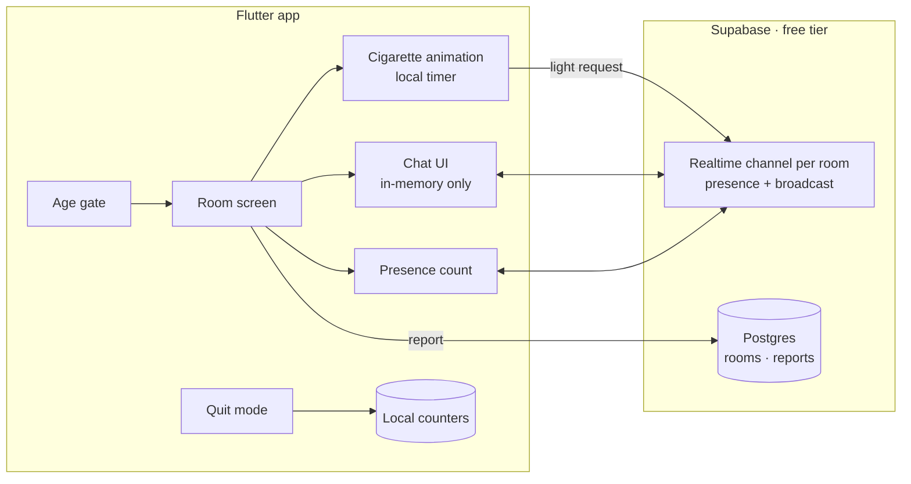

# Smoke Room

> Take a break together. Or skip the cigarette.

[](https://github.com/chiragparamesh/smoke_room/actions/workflows/build-apk.yml)

## Problem

The best part of a smoke break is often the break: stepping out, a few minutes of chat with whoever is there. Smoke Room recreates that as real-time virtual rooms. **Quit mode** is the lead feature: when a craving hits, join the room instead of lighting up. The app counts cigarettes avoided and money saved.

18+ only.

## Features

| Feature | Status |
|---|---|
| Project skeleton, dark theme, routing, CI APK build | ✅ Built |
| 18+ age gate | 🕓 Planned |
| One public room | 🕓 Planned |
| Live presence count (Supabase Realtime) | 🕓 Planned |
| Cigarette burn-down animation (~5 min, hold to drag, tap to flick ash) | 🕓 Planned |
| Ephemeral chat (disappears when your cigarette ends) | 🕓 Planned |
| Quit-mode counter (cigarettes avoided, money saved) | 🕓 Planned |
| Themed rooms with ambient sound (rainy terrace, chai stall, office fire exit, hostel rooftop) | 🕓 Planned |
| Ask someone for a light (lighter animates over) | 🕓 Planned |
| Anonymous names | 🕓 Planned |
| Private rooms via share link | 🕓 Planned |
| Profanity filter and report button | 🕓 Planned |

## Architecture



Chat messages travel over Realtime **broadcast** and are never written to the database, so they disappear by design.

Full design and roadmap: [docs/architecture.md](docs/architecture.md). Database schema: [supabase/schema.sql](supabase/schema.sql).

## Tech stack

| Layer | Choice |
|---|---|
| App | Flutter (Dart), Material 3 (dark), go_router |
| Realtime | Supabase Realtime: presence + broadcast |
| Database | Supabase Postgres with row-level security (rooms, reports) |
| Animation | CustomPainter + particle smoke |
| CI | GitHub Actions builds the release APK on every push |

## How to run

Create `env.json` in the project root (git-ignored):

```json
{ "SUPABASE_URL": "https://xxxx.supabase.co", "SUPABASE_ANON_KEY": "your-anon-or-publishable-key" }
```

```bash
flutter pub get
flutter run -d chrome --dart-define-from-file=env.json
```

For CI, add repo secrets `SUPABASE_URL` and `SUPABASE_ANON_KEY` (Settings → Secrets and variables → Actions). Install on the phone: **Actions → Build APK → latest run → `smoke_room-release-apk`**. APKs are never built locally.

## Screenshots

_Coming soon._

| Age gate | Room | Quit mode |
|---|---|---|
| _todo_ | _todo_ | _todo_ |
