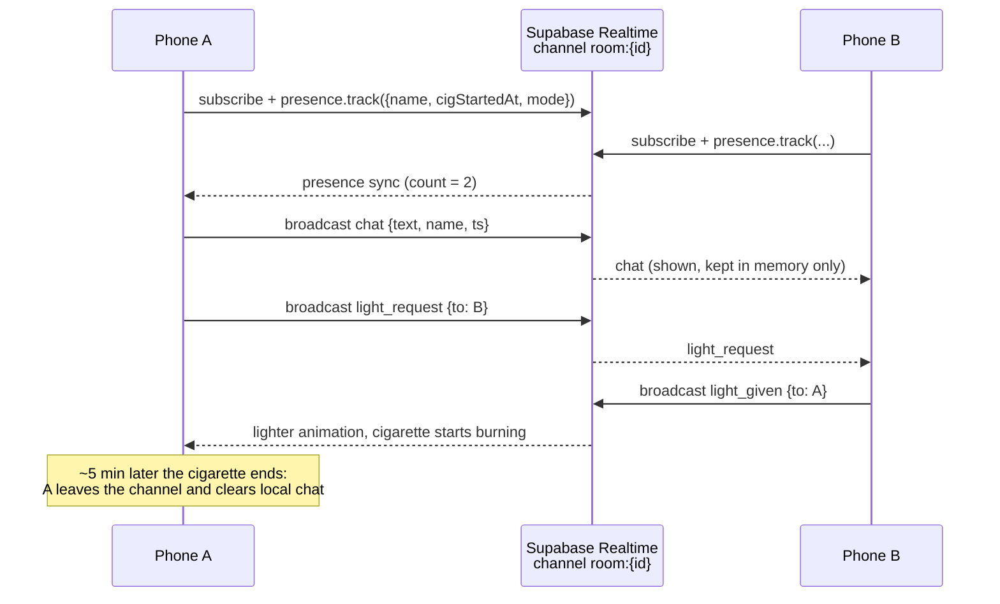

# Smoke Room — Architecture

## 1. Goal

Real-time, anonymous, ephemeral "smoke break" rooms, with a quit mode as the headline feature. It must run on the Supabase free tier and store as little as possible.

## 2. Overview

## 3. Realtime design

| Concern | Mechanism |
|---|---|
| Presence count | Realtime **presence** on channel `room:{roomId}`; payload `{anonName, cigStartedAt, quitMode}` |
| Chat | Realtime **broadcast** event `chat`; never persisted; client drops messages when its cigarette ends |
| Light | broadcast events `light_request` / `light_given` addressed by presence key |
| Ash flick / drag | local only (no network) |
| Private rooms | row in `rooms` with `is_private = true` and an unguessable `slug`; share link `https://…/r/{slug}` → deep link opens channel `room:{id}` |
| Reports | insert into `reports` (message text snapshot, reason); reviewed manually in the Supabase dashboard |

Free-tier limits (concurrent connections, messages per second) are handled with client-side rate limits (for example, 1 chat message per 2 s) and by leaving the channel when the app is backgrounded.

## 4. Data stored

Only `rooms` and `reports` live in Postgres (see `supabase/schema.sql`). There are no user accounts. Anonymous names are generated on-device (adjective + Bengaluru noun, e.g. "Sleepy Auto"). Quit-mode stats live only on the phone.

## 5. Cigarette model

- Burn time ≈ 300 s, driven by a local `Ticker`.
- Hold to drag: burn rate × 4, tip glow intensity up, smoke particle burst.
- Tap: flick ash (ash length resets, falling-particle animation).
- End: fade out, leave channel, wipe chat buffer.
- Drawn with `CustomPainter`; smoke as a lightweight particle system.

## 6. Quit mode

Toggle "I'm here instead of smoking". Each completed session in quit mode: `cigarettesAvoided += 1`, `moneySaved += pricePerCigarette` (user-set, default ₹20). Shown as a counter, streak, and milestones. Store listing leads with this feature.

## 7. Safety

- 18+ age gate on first launch (stored locally).
- Profanity filter on send (English + common Hindi/Kannada transliterations) and on receive.
- Report button on each message → `reports` table.
- Client rate limits; server-side RLS lets anonymous users insert reports but not read them.
- Store listing positioned around quitting/social breaks, not promoting smoking.

## 8. Configuration

Keys are injected with `--dart-define` (see `lib/core/services/supabase_config.dart`), from `env.json` locally and from repo secrets in CI. The anon/publishable key is designed to be public; RLS protects the data. The service-role key must never be in the app or the repo.

## 9. Planned packages

`supabase_flutter`, `audioplayers` (ambient loops), `share_plus` (private room links), `app_links` (deep links), `shared_preferences` (age gate, quit stats).

## 10. Roadmap

| Phase | Scope |
|---|---|
| 0 ✅ | Skeleton, dark theme, router, Supabase config hook, CI APK build |
| 1 | Age gate, quit-mode counter (local) |
| 2 | Supabase connection, one public room, presence count |
| 3 | Cigarette animation (burn, drag, ash flick) |
| 4 | Ephemeral chat + profanity filter + report button |
| 5 | Ask for a light, anonymous names |
| 6 | Themed rooms with ambient sound, private rooms via share link |
